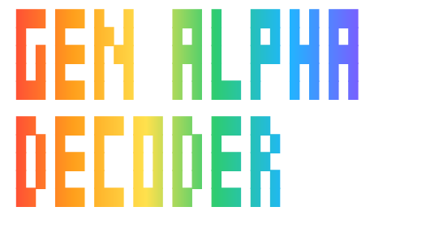

<p align="center"></p>

# Gen Alpha Decoder™ | Date — Lexicon Safety & Quality Pipeline

> **Derived teaching scaffold — not the production Gen Alpha Decoder codebase.**
> This repository contains only the lexicon-pipeline slice of Gen Alpha Decoder™
> (translate-easy.com), rebuilt with mock authentication, mock AI and moderation
> providers, and synthetic data, for the UNSW COMP3900/COMP9900 project with the
> Western Australian AI Hub. It is covered by your NDA: do not publish or share it.
> It contains safety rules and test phrases about self-harm and abuse; treat them with care.

Full scope, schedule and success criteria: [docs/SCOPE.md](docs/SCOPE.md).
Developer docs (guides, architecture, CI) and the Swagger API reference: see [Documentation site](#documentation-site).
To connect Claude Desktop, Gemini CLI, or ChatGPT on macOS, Linux, or Windows, use [Connect your AI assistant](docs/connect-assistant.md).

## Quick start

Requires Node.js 20+ and pnpm 9.

```bash
pnpm install
pnpm dev          # http://localhost:3000 → Lexicon Lab
```

No environment variables, API keys, or database install are needed. By default:

- **Database:** embedded [PGlite](https://pglite.dev) (real Postgres compiled to WASM), stored
  in `./.data/`, migrated from `./drizzle/` and **seeded with synthetic data** on first use:
  the public seed lexicon, ~6 months of anonymous search events per term, 27 missing-term
  suggestions full of near-duplicates, and 3 AI terms awaiting review. `pnpm db:reset` wipes it.
- **AI discovery:** a mock model that behaves like an imperfect real one (it knows some slang,
  hallucinates some made-up words, misses others, and mislabels a couple of sensitive terms) —
  so your evaluation harness has real errors to find. Every mock definition starts with `[Mock]`.
- **Moderation endpoint:** a mock that flags a few synthetic patterns, with configurable
  latency and failures for testing fail-closed behaviour.
- **Auth:** every request is the synthetic, signed-in user "Demo Reviewer".

Copy `.env.example` to `.env.local` to change any of these (see comments in that file).

## Documentation site

The docs live in `docs/` and are shown by a Docusaurus site in `website/`, with a Swagger page for the HTTP API.
It needs Node.js 20 or newer (check with `node -v`; with nvm, run `nvm use 24`).

```bash
pnpm --dir website install --ignore-workspace   # once
pnpm dev:all                                   # app: http://localhost:3000, docs: http://localhost:3001
```

- Docs pages: http://localhost:3001
- API reference (Swagger): http://localhost:3001/api. "Try it out" uses the app on http://localhost:3000, started by `pnpm dev:all`.
- Search only exists in a production build, not under `pnpm docs:dev`. To try it:

  ```bash
  pnpm --dir website build
  pnpm --dir website serve   # http://localhost:3000, or add --port 3001
  ```

The docs are private (NDA). The site tells search engines not to index it, and CI builds it as a check only.

## Docker

The course requires the final system to run in a container. Install Docker Desktop (or Docker Engine with the Compose plugin), then from the repo root:

```bash
docker compose up --build   # app: http://localhost:3000, docs: http://localhost:3001
docker compose down         # stop; the database volume is kept
docker compose down -v      # stop and delete the database volume (reset to seed data)
```

It runs offline with mock AI, mock moderation and synthetic data, so no keys or `.env.local` are needed. Build one image on its own:

```bash
docker build -t alpha-date .                                    # app
docker build -f website/Dockerfile -t alpha-date-docs .         # docs (context is the repo root)
docker run --rm -p 3000:3000 alpha-date
```

The docs build fails on broken links, as in CI. Both images run as a non-root user.

The app image also contains the vendored SIRS plotter (Python 3.12 plus its scientific packages), so the Aura charts work in the container. That makes the app image about 2.7 GB, and the first build takes about 6 minutes; later builds reuse the cached Python layer.

## Commands

| Command | Purpose |
| --- | --- |
| `pnpm dev` | Dev server |
| `pnpm dev:all` | App and docs development servers on ports 3000 and 3001 |
| `pnpm build` / `pnpm start` | Production build / serve (stop `pnpm dev` first — they share `.next/`) |
| `pnpm typecheck` | `tsc --noEmit` |
| `pnpm lint` | ESLint (Next.js rules) |
| `pnpm test` | Unit tests (`node:test` via tsx; in-memory database, instant mocks) |
| `pnpm test:ci` | Same tests as `pnpm test`, plus a `junit.xml` report (what GitLab CI runs) |
| `pnpm eval:validate` | Validate `eval/golden-set.json` and print counts |
| `pnpm eval` | Evaluation harness (**yours to build** — see `scripts/eval.ts`) |
| `pnpm aura:plot bussin "goofy ahh" [--out chart.png]` | Chart each term's SIRS lifecycle curve coloured by Aura stage (opens a window, or saves with `--out`). Runs the SIRS plotter vendored in `sirs/`; needs its Python venv (below) |
| `pnpm -s mcp` | Starts the read-only MCP server for assistive tech; waits for input, Ctrl+C stops it (see `docs/features/mcp-server.md`) |
| `pnpm aura:plot --list` | Print every term `aura:plot` accepts, grouped by generation |
| `pnpm db:generate` | Generate a SQL migration after editing `lib/_stubs/schema.ts` |
| `pnpm db:migrate` | Apply migrations to `DATABASE_URL` (your own hosted Postgres only) |
| `pnpm db:reset` | Delete the local PGlite database |
| `pnpm docs:dev` | Docs site from `docs/`, with the Swagger API reference at `/api`, on http://localhost:3001 (Node 20+; install once with `pnpm --dir website install --ignore-workspace`) |
| `pnpm --dir website build` | Build the docs site; broken links fail it (what CI's `docs` job runs) |

`aura:plot` and the MCP Aura graph need a Python 3.12 venv in `sirs/` (git-ignored, so everyone makes their own after pulling). Run `pnpm sirs:setup` once; it is safe to re-run. The guided assistant setup does the same. Manual equivalent:

```sh
# macOS / Linux
uv venv --python 3.12 sirs/.venv && uv pip install --python sirs/.venv/bin/python -r sirs/requirements.txt
# Windows (PowerShell)
py -3.12 -m venv sirs\.venv; sirs\.venv\Scripts\pip install -r sirs\requirements.txt
```

On macOS, if `aura:plot` fails with "The compiled dtaidistance C library is not available", rebuild that one package
from source (needs `brew install libomp`): `uv pip install --python sirs/.venv/bin/python --reinstall --no-binary dtaidistance dtaidistance==2.5.1`.

## Testing

Run the tests from the repo root. They run offline and need no keys.

| Layer | Command |
| --- | --- |
| TypeScript tests (app, safety, MCP, docs) | `pnpm test` |
| Same tests with a JUnit report (CI) | `pnpm test:ci` |
| Python tests (SIRS plotter) | `sirs/.venv/bin/pytest sirs/tests` |

### Test layers

| Layer | What it checks | Example files |
| --- | --- | --- |
| Unit | One function or component, with its dependencies replaced | `tests/normalise.test.ts`, `tests/termKey.test.ts`, `tests/safety-boundaries.test.ts` |
| Integration | Several parts together: pipeline, API routes, MCP server, database | `tests/pipeline.test.ts`, `tests/api-routes.test.ts`, `tests/mcp-server.test.ts`, `tests/search-merge-integration.test.ts` |
| Safety evaluation | The safety classifier against the golden set of phrases | `tests/golden.test.ts` |
| Python | The SIRS curve fit and plot code | `sirs/tests/test_fit_term.py` |
| End-to-end | The built container, run by hand (see below) | `tests/docker.test.ts` checks the container files |

### Mocks and sad cases

Tests never call a real service. `MOCK_LLM=true` replaces the AI model and the moderation endpoint. The database is PGlite, which runs in memory. Mocking lets a test force the failures that a real service gives only by chance.

Each feature has happy cases and sad cases. A sad case is a test where something goes wrong. These tests cover:

- Moderation failure: a stubbed network error or bad response makes moderation fail. The system must fail-closed, which means it blocks the write. The next request must work again (`tests/moderation-recovery.test.ts`).
- Forced failure: `tests/setup.ts` sets `MOCK_MODERATION_FAILURE_RATE` to 0. A safety test sets it to 1 so every moderation call fails (`tests/safety-responses.test.ts`).
- Hostile input: prompt injection, and personal data that must be redacted from a query (`tests/prompt-injection.test.ts`, `tests/input-privacy.test.ts`).

### Frontend

Component tests render each component to HTML and check the result. They also check the logic behind each user interaction, such as keyboard focus in the drawer and the zoom controls.

- Rendering: `tests/aura-chart-panel.test.ts`, `tests/safety-response-ui.test.ts`
- Interaction: `tests/lab-drawer-focus.test.ts`, `tests/dedup-zoom-controls.test.ts`, `tests/export-menu.test.ts`

### Backend

Backend tests call the route handlers and the stores directly.

- Input validation: `tests/api-routes.test.ts` (a blank query gives 400, a bad body gives 400)
- Business logic: `tests/counter.test.ts` (the AI-calls-avoided counter), `tests/dedup-store.test.ts`
- Error handling: `tests/moderation-recovery.test.ts`

### End-to-end

CI cannot run the real AI provider. It needs a paid key and gives a different answer each time, so a test would fail for reasons we do not control. The container is also not built in CI tests. Run this manual check instead:

1. Run `docker compose up --build`.
2. Open http://localhost:3000 and search `Rizz`. Expect the term with its definition.
3. Search `zorbleflux`. Expect a pending, unverified result.
4. Search `kms`. Expect the help resources, with no AI answer.
5. Open http://localhost:3001. Expect the docs site.

### Coverage

Run `pnpm test:coverage`. It runs the TypeScript tests under `c8` and prints a table per folder. It counts every file in `lib/`, `components/` and `app/`, including files that no test loads.

| Area | Lines | Branches |
| --- | --- | --- |
| `lib/` (business logic, safety, MCP, Aura, dedup) | 98.1% | 89.1% |
| `components/` | 52.7% | 83.3% |
| `app/` (Next.js pages and routes) | 14.4% | 64.1% |
| All three | 76.0% | 86.8% |

These numbers come from the run on 19 Nov 2026. The logic is well covered. The weak parts are the page and layout files, which Next.js renders itself. `components/review` and `components/search` have no tests yet. The Python tests in `sirs/tests` are not in this table.

### Known gaps

- `components/review`, `components/search` and most `app/lab` pages have 0% coverage.
- No test forces two requests at the same time, so race conditions are not covered.
- The real AI provider and real moderation endpoint are never tested.

## What already works (baseline)

**Search** → **safety gate** → lexicon lookup → AI discovery → saved as `pending_review` →
**Review queue** (publish/reject). Unknown terms offer a **suggestion** form; suggestions are
listed by count. Try: `Rizz` (found), `brainrot` (discovered), `zorbleflux` (pending,
hallucinated), `kms` (sensitive lookup → help resources), and a first-person crisis
statement (safeguarding panel, no AI call).

The safety baseline is **production's own code**, copied on 2 Oct 2026: the deterministic
classifier (`lib/safety/classify.ts`), verified Australian help resources
(`lib/safety/resources.ts`), the crisis card and help panel (`components/safety/`), and its
59 regression cases (in `eval/golden-set.json`, `source: "prod-regression"`; all pass in
`pnpm test`). Production also runs a separate model-based moderation layer, which is not
included.

## What you are building

| Feature | Start here | Contract |
| --- | --- | --- |
| Input safety gate | `lib/safety/gate.ts`, `lib/_stubs/moderation.ts` | `checkInputSafety(text, surface) → SafetyVerdict` |
| Discovery evaluation harness + golden set (150+) | `scripts/eval.ts`, `eval/golden-set.json`, `lib/eval/golden.ts` | `pnpm eval`; discovery function injected |
| Suggestion normalisation & dedup + triage view | `lib/normalise/index.ts`, `app/lab/review/page.tsx` | `normaliseSuggestion(text)`, `findLikelyMatches(text, candidates)` |
| Aura lifecycle scoring + badge | `lib/aura/index.ts` | `scoreTermLifecycle(events) → AuraScore` |
| *Stretch:* prompt-version comparison in the eval report | `lib/discovery/prompt.ts` | versioned prompt builders |

Each contract file explains what is expected. Where to add value on the safety gate, given
production already has rules: combine rules with the moderation endpoint, **fail closed**,
decide a policy per surface (e.g. today a *suggestion* of a sensitive term like "kms" is
accepted as a normal suggestion — should it be?), and improve the rules wherever your golden
set finds misses or false positives. Every rule fix you prove with a new golden-set case can
go straight into production's regression suite.

### Continuous integration (GitLab)

`.gitlab-ci.yml` runs on every merge request and on pushes to branches and tags. It uses the
mock AI and mock moderation only, so it needs no API keys or CI/CD variables.

| Job | Runs locally as |
| --- | --- |
| `lint` | `pnpm lint` |
| `typecheck` | `pnpm typecheck` |
| `unit-tests` | `pnpm test:ci` (JUnit report shows in the merge request) |
| `eval` | `pnpm eval` (report kept as a downloadable artifact) |
| `dependency-audit` | `pnpm audit --prod --audit-level=high` (warns, does not block, until `next` is upgraded) |
| Secret detection and SAST | GitLab's built-in scan templates (no local command) |
| `build` | `pnpm build` (starts only after lint, typecheck, unit-tests and eval pass) |

To reproduce a pipeline before pushing, run the first four commands in the table, then `pnpm build`.
CI uses Node 24.18.0 and the pnpm version pinned in `package.json`.

### Integration rules (how your work gets into production)

WA AI Hub ports your modules into the production codebase, which you never see. To make
that possible:

1. **Keep production shapes.** `app/types.ts` (`SlangTerm`), `SafetyCategory`/`CrisisKind` in
   `lib/safety/classify.ts`, and the table/column names in `lib/_stubs/schema.ts` mirror
   production. Add fields; don't rename or remove them.
2. **Contract modules are pure.** `lib/safety/gate.ts`, `lib/normalise`, `lib/aura`,
   `lib/discovery/discover.ts` and the eval code take their inputs (events, candidates, model
   function, moderation function) as parameters or via the stub modules — no direct database
   or SDK calls inside them.
3. **Only import from `lib/_stubs/` at the edges** (server actions, stores, the eval script).
   Everything under `lib/_stubs/` is replaced by real implementations in production.
4. **Changes to `lib/safety/classify.ts`** must keep every `prod-regression` case passing, and
   must come with new golden-set cases demonstrating each change.
5. **Schema changes** go through `pnpm db:generate` and are listed in your write-up.

## Rules (non-negotiable)

- **No real data.** Synthetic or publicly documented inputs only — never real user searches,
  real messages, or anything about a real person. Golden-set safety phrases are test strings.
- **Usage events stay anonymous.** Never add user ids, IP addresses, session ids or device data
  to `term_events` — not even synthetic ones. `term_feedback.user_ip` stays null.
- **Credentials live in env vars only.** Never commit `.env*` files (only `.env.example`).
  If you use a real AI key (`MOCK_LLM=false`), it is your own, with a hard monthly spend cap.
- **Your own infrastructure.** `DATABASE_URL`, if set, is your own Postgres (e.g. Neon free
  tier) — never production. Deploy only to your own Vercel sandbox.
- **Out of scope / not in this repo:** production auth, billing, the Educator Workspace,
  school management, the production safety log and incident process, and its model-based
  moderation layer.
- **Help resources** (`lib/safety/resources.ts`) were verified against official sources by
  WA AI Hub. Don't change numbers or wording; propose changes instead.
- **Standards:** Australian English (en-AU) in all UI copy; WCAG 2.2 AA.
- **Dependencies:** WA AI Hub's tooling blocks package versions published in the last few
  days (supply-chain control). Prefer established releases, and justify each new dependency.

## Project layout

```
app/lab/                 Lab pages + server actions (actions.ts)
components/search/       Search panel (client)
components/safety/       Crisis card + help resources (from production)
components/review/       Review buttons (from production)
components/ui/           Shared UI primitives (shadcn/ui, from production)
lib/safety/              Production classifier + resources; gate.ts contract
lib/discovery/           Discovery prompt (production) + discover.ts (injected model)
lib/normalise/           Dedup contract + production similarity helpers
lib/aura/                Lifecycle scoring contract
lib/eval/golden.ts       Golden-set schema and loader
lib/terms-store.ts       Lexicon + anonymous event persistence
lib/feedback.ts          Suggestion persistence (baseline exact-match dedup)
lib/_stubs/              Mock auth, PGlite/Postgres client, schema, seed, mock AI and moderation
eval/golden-set.json     Starter golden set (81 cases)
scripts/eval.ts          Eval CLI entry point
drizzle/                 SQL migrations (generated)
tests/                   Unit tests
docs/SCOPE.md            Approved scope and schedule
```

## Known issues (good first tasks for the Sprint 3 accessibility pass)

Found by an axe-core WCAG 2.2 AA scan of the baseline on 2 Oct 2026. Production uses the same
colours, so fixes here are reusable:

- Destructive buttons and badges (`bg-destructive`, e.g. **Reject**, "Use With Caution") have
  3.76:1 contrast with white text, below the 4.5:1 AA threshold.
- Default (`bg-primary`) buttons drop below 4.5:1 in their hover state (`hover:bg-primary/90`).
- While a toast is visible, the Radix toast viewport reports `aria-hidden-focus` and `list`.

## Mock provider controls

| Variable | Default | Effect |
| --- | --- | --- |
| `MOCK_LLM` | `true` | `false` + `OPENAI_API_KEY` → real discovery model and real moderation endpoint |
| `MOCK_LLM_LATENCY_MS` | `300` | Simulated discovery latency |
| `MOCK_LLM_FAILURE_RATE` | `0` | Fraction of discovery calls that fail |
| `MOCK_MODERATION_LATENCY_MS` | `150` | Simulated moderation latency |
| `MOCK_MODERATION_FAILURE_RATE` | `0` | Fraction of moderation calls that fail — use it to test fail-closed |
| `OPENAI_MODEL` | `gpt-4o-mini` | Discovery model in real mode |

## Team

Gen Alpha Decoder™ | Date · alpha-date@wahub.ai · weekly meeting Tue 3 pm WST.
