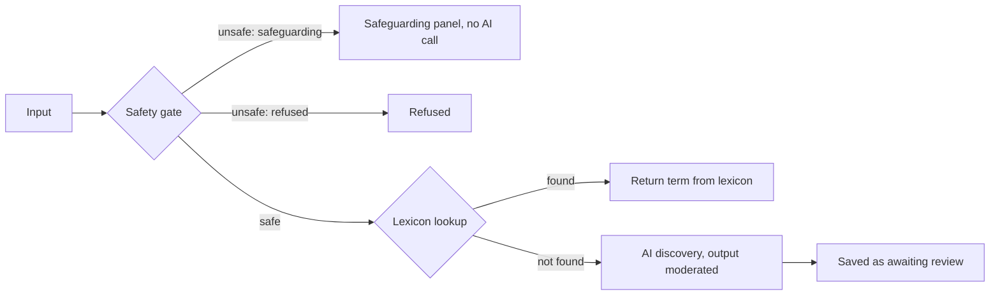
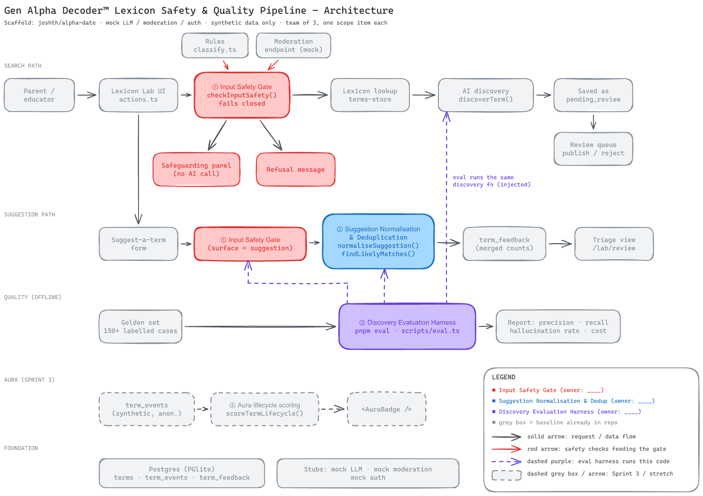

# Architecture

A search or suggestion moves through the pipeline in this order:

input → safety gate → lexicon lookup → AI discovery → stored for review

The safety gate always runs first. No input reaches the lexicon lookup or the AI model before it passes the gate.

- **Unsafe input** stops at the gate. The user sees either the safeguarding panel or a refusal.
- **A term found in the lexicon** is returned from the lexicon.
- **Any other term** goes to AI discovery. The model output is moderated. The result is saved as awaiting review. A reviewer then publishes or rejects it in the Review queue.

## Key folders

| Folder | What it holds |
| --- | --- |
| `lib/safety` | Safety classifier, help resources and the input gate contract (`gate.ts`) |
| `lib/discovery` | Discovery prompt and `discover.ts`, which takes the model as a parameter |
| `lib/normalise` | Suggestion normalisation and deduplication contract, plus similarity helpers |
| `lib/eval` | Golden-set schema and loader, and the safety evaluation code |
| `app/lab` | Lab pages and server actions (`actions.ts`) |
| `drizzle/` | SQL migrations, generated by `pnpm db:generate` |
| `eval/` | `golden-set.json`, the golden set |

Everything under `lib/_stubs/` is a stand-in for production code. Import from it only at the edges, such as server actions, stores and the eval script.
