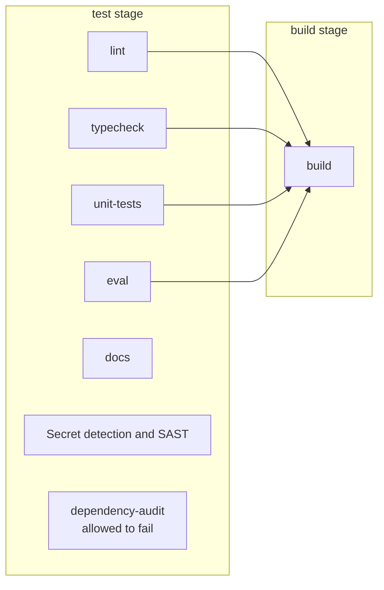

# CI pipeline

The GitLab pipeline is defined in `.gitlab-ci.yml`. It runs on every merge request and on pushes to branches and tags.

Every job runs offline. The jobs use the mock AI and mock moderation only, and in-memory PGlite. The pipeline needs no API keys and no CI/CD variables. The `MOCK_LLM` variable is set to `"true"` in the file, so CI never calls a real provider.

## One pipeline per change

Each change gets one pipeline. While a merge request is open, the merge request pipeline runs. Otherwise, a branch pipeline runs. Newer commits cancel older runs.

## Stages and jobs

The pipeline has two stages: `test` and `build`.



`docs`, the scans and `dependency-audit` run in parallel with the other test jobs. `build` does not wait for them.

| Job | Stage | What it does | Runs locally as |
| --- | --- | --- | --- |
| `lint` | test | ESLint | `pnpm lint` |
| `typecheck` | test | TypeScript check | `pnpm typecheck` |
| `unit-tests` | test | Unit tests with a JUnit report, which shows in the merge request | `pnpm test:ci` |
| `eval` | test | Evaluation harness. The report is kept as a downloadable artifact. | `pnpm eval` |
| `dependency-audit` | test | Audits production dependencies. It warns but does not block, until `next` is upgraded. | `pnpm audit --prod --audit-level=high` |
| Secret detection and SAST | test | GitLab's built-in scan templates | No local command |
| `docs` | test | Builds the docs site. Broken links fail it. | `pnpm --dir website build` |
| `build` | build | Production build. It starts only after `lint`, `typecheck`, `unit-tests` and `eval` pass. | `pnpm build` |

The `dependency-audit` job is allowed to fail. The `build` job does not wait for the secret detection, SAST or audit jobs.

## The docs job

The `docs` job (test stage) installs `website/` from its own lockfile and runs the Docusaurus build. Docusaurus fails the build on any broken link, so this job also checks every link in the docs. The site is built as a check only and is never published, because the project is under NDA.

## Run the same checks locally

Run these before you push:

```bash
pnpm lint
pnpm typecheck
pnpm test
pnpm eval
pnpm build
pnpm --dir website build
```

The last command needs the docs dependencies first: `pnpm --dir website install --ignore-workspace`.

CI uses Node 24.18.0 and the pnpm version pinned in `package.json`. Your local Node version may differ. See [Getting started](./getting-started.md) for local setup.
