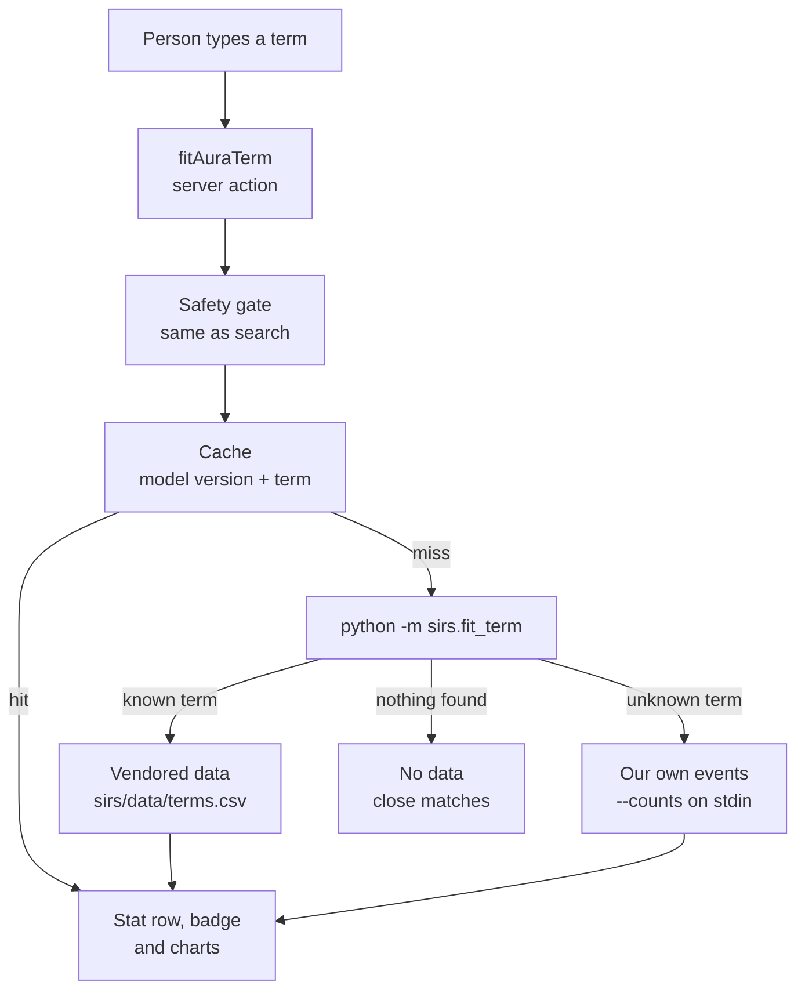

# Aura and dedup dashboard

The Aura page in the Lexicon Lab (`/lab/aura`) lets a reviewer or educator see where a slang term sits in its lifecycle, and what normalisation and deduplication did to the suggestions. It has two tabs, **Lifecycle** and **Dedup**. Both stay mounted, so a fit is not lost when you switch tabs.

It uses the dashboard design language in `DESIGN.md`: a dark header and sidebar around a content surface, IBM Plex type, and Okabe-Ito stage colours. Every stage also has a shape and a text label, so colour is never the only channel.

## Lifecycle tab

Type a term and press **Fit**. The page shows the stage badge, a stat row (`r`, `Δ`, peak week and confidence), a one-sentence summary, and three charts. The stage rule is the one in [Aura](./aura.md).

Two honest outcomes are part of the design:

- **No data.** If the term has no series anywhere, the page says "No search data for this term", draws no chart, and offers up to three close known terms.
- **No stage yet.** If the fitted curve has not taken off, the page still shows the charts and says "No stage yet: the curve hasn't taken off". The same happens when the curve contributed nothing to the fit, so a flat series can never be labelled "emerging".

## How a fit runs

The server action trims the term, runs it through the safety gate like search does, and checks an in-memory cache keyed by the model version and the normalised term. On a miss it starts `python -m sirs.fit_term TERM --json` in the `sirs/` virtualenv. A term in `sirs/data/terms.csv` is fitted from the cached shared parameters in `sirs/results/fits_main.json`. Any other term uses its own weekly event counts, aligned to the same shared parameters with no new optimisation. The page never calls a live search-trend API.

A cold Python start takes a few seconds. Repeat lookups come from the cache.

## Charts and their text alternatives

There are three charts: weekly search interest with the fitted curve, the susceptible, infected and recovered shares, and the feedback term Γ(t). The interest series is scaled 0 to 1 over the whole history, so for a weakly fitted term the fitted curve can sit well below the dots. The confidence figure says how well the curve fits.

On the main chart the last 180 days are shaded, "Now" is marked, and a dashed line marks 80% of the fitted peak.

Each chart has:

- a one-sentence summary, the same sentence everywhere ("Down 48% from its peak, down 2 points in the last 180 days.");
- a **Show as table** toggle that swaps the chart for a table of the same weekly values;
- a legend that shows each line style, because every series differs in line style as well as colour;
- axes with a grid and a tooltip on hover.

Chart points use a roving tab stop: one Tab press enters the chart and the arrow keys, Home and End move between points, with the focused point shown in text above the chart.

## Trend you can read or hear

Under the stat row, the trend sentence is always shown. Below it, a closed disclosure called **Trend table and sound** opens to show a **Play trend** button, a **Volume** slider, and a table of the weekly fitted points in the 180-day window. The table has a caption and header cells.

Pressing **Play trend** plays the fitted curve `I(t)` as pitch over about 3 seconds. A higher value is a higher note. The curve is cut to at most 24 notes, and each note is snapped to a C major pentatonic scale over two octaves, so it sounds like a tune and not a siren.

After the curve, a short cue for the stage plays:

| Stage | Cue |
|---|---|
| Emerging | Two rising notes (C up to G) |
| Peaking | A rising four-note chime (C, E, G, C) |
| Declining | Two falling notes (G down to C) |
| Parent territory | A tritone (C then F sharp), which sounds unsettled |

Sound never plays on its own. It starts only when the button is pressed, the button turns into **Stop** while it plays, and the slider sets the volume for the next play. This follows WCAG 1.4.2 Audio Control.

A term with "No stage yet" keeps the sentence and the table but has no **Play trend** button.

The idea comes from Enhanced Listen Mode in The Last of Us Part II, where pitch follows height.

Files:

- `lib/aura/sonify.ts` turns the curve into notes, builds the stage cues, and plays them with Web Audio.
- `components/aura/trend-player.tsx` holds the button and volume.
- `components/aura/aura-trend.tsx` renders the sentence, disclosure and table.

## Dedup tab

The counter shows what normalisation did to the suggestions table. The table already merges exact matches on trimmed lower case, so that is the baseline. The counter then shows:

- rows before, and distinct keys after `normaliseSuggestion`;
- rows merged and the percentage reduction;
- storage saved in bytes, measured with `pg_column_size`;
- review items saved.

A time figure is labelled **Estimate**, shows its assumption ("2 min per review"), and the assumption can be edited. Numbers are read when the tab loads and again when the assumption changes.

## Similarity graph and threshold

Under the counter, a graph links suggestions and lexicon terms that the matcher thinks are the same word. Suggestions are filled circles and lexicon terms are outlined, sized by submissions. Edge style shows the reason: solid for the same key, dashed for trigram similarity, dotted for a stem match. A legend explains them.

A threshold slider (0.30 to 1.00, default 0.50) hides edges below the chosen score. It filters what is drawn and never changes stored data. The layout is computed once, so moving the slider does not move nodes.

The counter under the slider says how many suggestion pairs are joined at that threshold, and, when the golden set is available, the merge precision and recall on its eight dedup cases. On the seeded data, going from 0.50 to 0.70 takes the pairs from 14 to 6 and the recall from 1.00 to 0.67, with precision staying at 1.00. That is the evidence for choosing a threshold. The number of pairs is not the same as the counter's "Rows merged" (5 on the seeded data), because a pair count and a row count measure different things.

Select a node (Enter) to dim the rest and list its matches with their scores and signals. Arrow keys move to the nearest connected node in that direction. Below 768 px the clusters show as a table by default.

## Meaning matches

Words that mean the same but are spelled differently ("cap" and "lie") are missed by a spelling-based matcher. A toggle, **Show meaning matches**, adds a fourth edge type, drawn as a double line, between words whose embedding vectors have a cosine similarity of 0.85 or more.

These are hints for a reviewer. Meaning matches never merge rows and never change a count.

- In mock-LLM mode the vectors come from a small hand-made table in `lib/dedup/embeddings.ts`. It covers nine words, is illustrative and not real embeddings, and needs no key. Tests and CI use it.
- With a key and mock mode off, the vectors come from the AI SDK's `embedMany`. This sends the suggestion words to the embedding provider, and it is not exercised by the tests.

## Accessibility checks

axe-core reports no violations on either tab (WCAG 2.0, 2.1 and 2.2 A and AA rules plus best practice), with a fitted term loaded. Names, roles and live regions are asserted in tests, and the keyboard paths were driven in a browser. See the [design audit](../audits/lab-aura-slop-audit.md) for the findings, the fixes and what was not verified.

## Limits

- The Python fit runs per request and is cached in memory. For production the fit should move to a batch job that writes series to the database.
- A weak fit is shown as it is, with its confidence, instead of being tidied up.
- The golden set has eight dedup cases, so the precision and recall figures are rough.
- Narrow-width screenshots (375 and 768 px) and screen-reader testing were not done.
- The "signature" animation of the curve drawing in once is not built. Charts do not animate.
