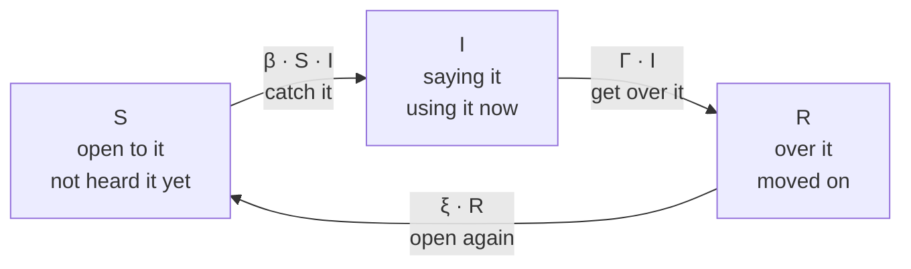
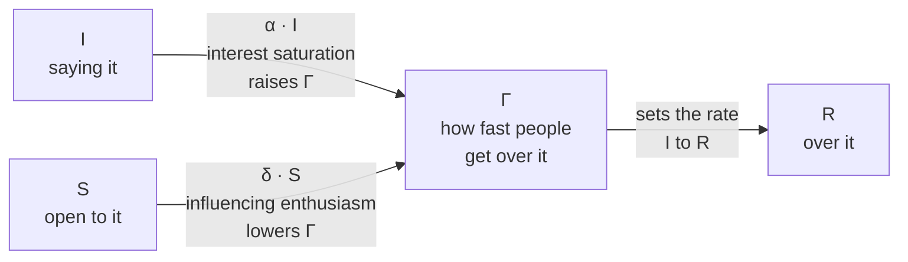

# Aura Lifecycle

Slang moves fast. Aura tells parents and educators whether a term is new, at its peak, fading, or already "parent territory", using nothing but anonymous search trends.

## The four stages {#stages}

- **Emerging**: Rising fast. Kids are starting to use it.
- **Peaking**: Close to its all-time high. Everyone is using it.
- **Declining**: Falling clearly from its peak.
- **Parent territory**: Past its peak and flat. If parents know it, it isn't cool any more.

## Interface {#interface}

```ts title="lib/aura/index.ts"
export type AuraStage = "emerging" | "peaking" | "declining" | "parent_territory"

export interface TermEvent { eventType: string; createdAt: Date }   // anonymous: no user, IP or session

export interface AuraScore {
  stage: AuraStage
  confidence: number      // 0–1; low when there is too little data
  explanation: string     // plain English, shown to reviewers
}

export function scoreTermLifecycle(events: TermEvent[], now?: Date): AuraScore | null
```

`AURA_STAGE_LABELS` gives the display names ("Emerging", "Peaking", "Declining", "Parent territory"). The function is pure: it takes events and returns a stage, with no database access.

:::warning[Status]

The stage rule, the lifecycle charts and the TypeScript scorer all work today (see [The TypeScript scorer](#scorer)). The `<AuraBadge />` component is still to come.

:::

## How a term's lifecycle is modelled {#model}

Slang spreads like a cold: people pick it up from each other, use it for a while, then lose interest. Aura fits each term's weekly search counts with a modified **SIRS** model, a standard model of how things spread through a population:

| Share | Meaning for slang |
|----|----|
| **S**usceptible | People who haven't picked the term up yet |
| **I**nfected | People using or searching it now. This curve is what Aura reads. |
| **R**ecovered | People who have moved on |
| Γ (recovery rate) | Changes over time: interest drops faster once a term is everywhere |

People move around this loop. They catch the term from someone who is already saying it, get over it, and after a while become open to it again:



Everyone is in exactly one of the three groups, so the shares add up to one, and the recovered share follows from the other two:

$$
S + I + R = 1 \quad\Rightarrow\quad R = 1 - S - I
$$

The model then has three equations. Time is measured in weeks.

$$
\begin{aligned}
\frac{dS}{dt} &= -\beta\, S\, I + \xi\,(1 - S - I) \\[1em]
\frac{dI}{dt} &= \beta\, S\, I - \Gamma\, I \\[1em]
\frac{d\Gamma}{dt} &= \Gamma\,(\alpha I - \delta S)
\end{aligned}
$$

- $\beta$ is how fast the term spreads: it needs someone saying it ($I$) to meet someone open to it ($S$).
- $\Gamma$ is how fast people get over it. Plain SIRS keeps it fixed. Here it changes with $S$ and $I$ (the third equation), and the model fits $\log\Gamma$ so that $\Gamma$ always stays positive.
- $\xi$ is how fast people who got over it become open to it again.
- $\alpha$ and $\delta$ set how strongly the crowd saying the term ($\alpha I$) and the people still open to it ($\delta S$) push $\Gamma$ up or down.

### The feedback loop

Plain SIRS keeps the recovery rate fixed, so a term always settles to the same steady level. Here $\Gamma$ reacts to the crowd, following Mazzarisi et al. (2024):

- When many people are saying the term ($\alpha I$), it is oversaturated and less novel, so $\Gamma$ rises and people drop it faster. The authors call this interest saturation.
- When many people are still open to it ($\delta S$), the few who say it keep promoting it, so $\Gamma$ falls. This is influencing enthusiasm, after Bisin and Verdier (2001).



Fitting gives a smooth, noise-free curve I(t) for each term, so the stage depends on the trend rather than on one noisy week.

## The stage rule {#stage-rule}

Everything is measured relative to the term's own peak, so a niche term and a viral one are judged the same way.

$$
r = \frac{I(\text{now})}{I_{\text{peak}}}
$$

$$
\Delta = \frac{I(\text{now}) - I(\text{now} - 180\ \text{days})}{I_{\text{peak}}}
$$

Here $r$ is how close the term is to its peak, and $\Delta$ is how much it changed over the last 180 days, as a share of the peak.

The first rule that matches wins:

1.  **Peaking** if $r \ge 0.80$.

2.  If the curve is **flat** ($|\Delta| < 0.20$): **parent territory** if the peak has passed, otherwise not yet a stage (the term hasn't taken off).

3.  **Emerging** if $\Delta \ge 0.20$.

4.  **Declining** if $\Delta \le -0.20$.

:::tip[Why 0.20?]

Search counts are noisy. The 0.20 floor is the smallest change that still shows up as a clear difference (about two standard errors) between the first and last 60 days of the 180-day window, at realistic daily search rates. Anything smaller can't be told apart from noise, so it isn't called a trend.

:::

## The TypeScript scorer {#scorer}

`scoreTermLifecycle` in `lib/aura/index.ts` reads raw search events, not a fitted curve, so it cannot use the noise-free rule above as it stands. It also exports `auraTrend(events, now)`, which returns 26 weekly counted totals scaled 0 to 1 (oldest first). The MCP server's `get_aura_trend` uses it.

**The window.** The scorer counts every event except `llm_generated` and `prompt_generated` (the app makes those, not searchers). It keeps events from the 180 days before `now` and counts them per day.

| Constant | Value | Meaning |
|----|----|----|
| `MIN_EVENTS` | 30 | Fewer counted events than this gives no stage ("No stage yet") |
| `BLOCK_DAYS` | 60 | Days averaged at each end of the window for the first and last levels |
| `PEAK_SMOOTH_DAYS` | 30 | Width of the rolling mean used to find the peak |
| `FLOOR` | 0.15 | Smallest change, as a share of the peak, that counts as a trend |
| `R_PEAK` | 0.9 | Share of the peak at or above which a term is peaking |
| `R_RISING_PEAK` | 0.95 | A rising term this close to its peak is peaking, not emerging |
| `FULL_CONFIDENCE_EVENTS` | 365 | Counted events at which confidence reaches 1 |
| `LOW_CONFIDENCE` | 0.4 | Below this confidence the stage is shown as "low confidence" |

The scorer takes the mean daily count of the first 60 days (first) and of the last 60 days (last). The peak is the highest 30-day rolling mean in the window. Then:

$$
r = \frac{\text{last}}{\text{peak}}
\qquad
\Delta = \frac{\text{last} - \text{first}}{\text{peak}}
$$

The first rule that matches wins:

1.  If $\Delta \ge 0.15$: **peaking** when $r \ge 0.95$, otherwise **emerging**.

2.  **Peaking** if $r \ge 0.9$.

3.  **Parent territory** if $|\Delta| < 0.15$.

4.  Otherwise **declining**.

**Confidence** is the number of counted events divided by 365, capped at 1. A term with 146 events scores 0.4. Below 0.4 the stage is still returned, but it is shown as "low confidence".

**Explanation** is one sentence built from the same $r$ and $\Delta$. For example, "At 24% of its 180-day peak, down 68 points in 180 days." or "At 100% of its 180-day peak, level over 180 days."

### How accurate it is

The test in `tests/aura-score.test.ts` runs the scorer on the held-out test split of the SIRS fixtures: 77 cases, vendored as daily counts in `tests/fixtures/aura-fixtures-test.json`. It gets **63.6%** right (49 of 77). Guessing would get 25%. The test fails if accuracy drops below 55%.

`R_PEAK` and `FLOOR` were tuned on the train split only. The test split was not used to pick them.

It is wrong about a third of the time. The main errors:

- Terms that are flat after a peak are read as **peaking** instead of parent territory.
- Terms that are still rising but near their peak are read as **emerging** instead of peaking.

### Why the thresholds differ from the noise-free rule

The rule in [The stage rule](#stage-rule) (0.8 and 0.2) labels the fitted curve. That curve knows the true peak, even when the peak was long ago. The scorer sees only 180 days of noisy counts. If the peak came before the window, it cannot see it, so the window's own highest point looks like the peak. A term that has been flat for months then looks close to its peak. The scorer needs different thresholds (0.9 and 0.15) to do best on that data, and it still makes the errors above.

## Charting a term {#plot}

`pnpm aura:plot` draws each term's fitted lifecycle curve, coloured by stage, from the SIRS model vendored in `sirs/`.

```
pnpm aura:plot bussin "goofy ahh"            # opens a chart window
pnpm aura:plot bussin --out chart.png        # saves the chart instead
pnpm aura:plot --list                        # every term it accepts, by generation
```

It needs a Python 3.12 environment in `sirs/`, made once:

```
# macOS / Linux
uv venv --python 3.12 sirs/.venv && uv pip install --python sirs/.venv/bin/python -r sirs/requirements.txt
# Windows (PowerShell)
py -3.12 -m venv sirs\.venv; sirs\.venv\Scripts\pip install -r sirs\requirements.txt
```

Set `SIRS_DIR` to use a copy of the plotter somewhere else.

## Test data and privacy {#data}

The seeded database has about six months of **synthetic** search events for each seed term, generated with a known shape so the rule can be tested against the right answer:

| Shape                    | Example terms                                 |
|--------------------------|-----------------------------------------------|
| Emerging                 | `delulu`, `situationship`, `the roman empire` |
| Peaking                  | `rizz`, `skibidi`, `gyatt`                    |
| Declining                | `simp`, `sus`, `npc`                          |
| Faded (parent territory) | `poggers`, `cheugy`, `big yikes`              |

Events carry only a term, an event type and a time. No user ID, IP address or session is stored, and the rule is written to work on real anonymous data, not tuned to the generator.

## Files and tests {#files}

| File | Purpose |
|----|----|
| `lib/aura/index.ts` | The contract: stages, labels and `scoreTermLifecycle` |
| `tests/aura-score.test.ts` | Checks the scorer on hand-built shapes and on held-out SIRS fixtures (accuracy of at least 55%) |
| `tests/fixtures/aura-fixtures-test.json` | The 77 held-out test cases, as daily counts |
| `lib/aura/plot-command.ts`, `scripts/aura-plot.ts` | The `pnpm aura:plot` command |
| `sirs/src/sirs/model.py` | The modified SIRS model |
| `sirs/src/sirs/stages.py` | The stage rule and its noise floor |
| `lib/_stubs/fixtures/synthetic.ts` | Synthetic event shapes |
| `tests/aura-plot.test.ts`, `sirs/tests/` | Tests for the command and the charts |
