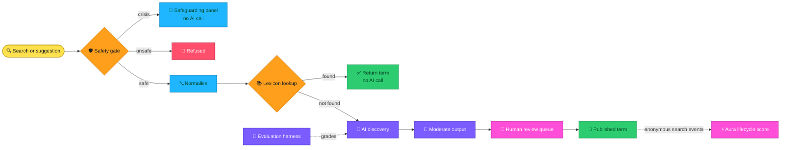

# Introduction

Gen Alpha Decoder™ | Date is a derived teaching scaffold. It is not the production Gen Alpha Decoder codebase.

The repository contains only the lexicon pipeline slice of Gen Alpha Decoder™. It was rebuilt with:

- mock authentication
- mock AI and moderation providers
- synthetic data

It was made for the UNSW COMP3900/COMP9900 project with the Western Australian AI Hub.

**NDA:** This repository is covered by NDA. Do not publish or share it.

**Content warning:** It contains safety rules and test phrases about self-harm and abuse. Treat them with care.

## What it does

Gen Alpha Decoder explains youth slang to parents and educators. When someone searches a word the lexicon doesn't know, an AI decides whether it's real slang and writes a meaning. This repository covers the four parts of that pipeline that keep it safe and accurate.

## How it flows

| Feature | What it does | Interface | Where |
| --- | --- | --- | --- |
| [Input Safety Gate](./features/safety-gate.md) | Checks every search and suggestion before any AI call. Crisis inputs go to Australian support services. | `checkInputSafety(text, surface) → SafetyVerdict` | `lib/safety/gate.ts` |
| [Evaluation Harness](./features/evaluation-harness.md) | Gives the AI an exam on a labelled answer key and reports precision, recall, hallucination rate, cost and time. | `pnpm eval` and the golden-set file format | `scripts/eval.ts`, `eval/golden-set.json` |
| [Normalisation and Deduplication](./features/normalisation.md) | Turns "Brain Rot!", "brain-rot" and "brainrot" into one key, and finds likely matches in the lexicon. | `normaliseSuggestion(text)`, `findLikelyMatches(text, candidates)` | `lib/normalise` |
| [Aura Lifecycle](./features/aura.md) | Places each term in a stage, from emerging to parent territory, using anonymous search trends. | `scoreTermLifecycle(events) → AuraScore` | `lib/aura` |

Each feature is a self-contained module behind an agreed interface, so the Western Australian AI Hub can port it into production without the team seeing the production repository. Contract modules are pure: they take their inputs (events, candidates, the model function, the moderation function) as parameters and never call the database or an SDK directly. Only server actions, stores and the eval script import from `lib/_stubs/`.

## Try it in the app

Start the app (see [Getting started](./getting-started.md)), open the Lexicon Lab and search for:

| Search | What happens |
| --- | --- |
| `Rizz` | Found in the lexicon. No AI call is made. |
| `brainrot` | Not in the lexicon, so the AI discovers it and it is saved for review. |
| `zorbleflux` | A made-up word. The mock AI is deliberately imperfect, so this shows a hallucination being stored for review. |
| `kms` | A sensitive lookup: allowed, with help resources shown beside the answer. |
| A first-person crisis statement | Stopped by the safety gate. The safeguarding panel is shown and no AI call is made. |

## Privacy and safety rules

- **No real data.** Every test input is synthetic or publicly documented. Suggester IP addresses are replaced with synthetic documentation-range values.
- **Anonymous events only.** Usage events carry a term, a type and a time. No user ID, IP or session identifier is ever added, even to synthetic data.
- **No production credentials.** Configuration is environment variables only. A real AI key, if used, is the team's own, with a spend cap.
- **Safety text stays out of reports.** Reports and logs refer to safety cases by id, never by their text.

## Where to go next

- [Getting started](./getting-started.md): install, run and test the project.
- [Architecture](./architecture.md): the pipeline order and the key folders.
- [HTTP API](./http-api.md): the search and suggestion endpoints.
- [CI pipeline](./ci.md): what GitLab runs and how to run the same checks locally.
- [Glossary](./glossary.md): plain-English definitions of the technical terms.

For the full scope, schedule and success criteria, see [Project scope](./SCOPE.md).
